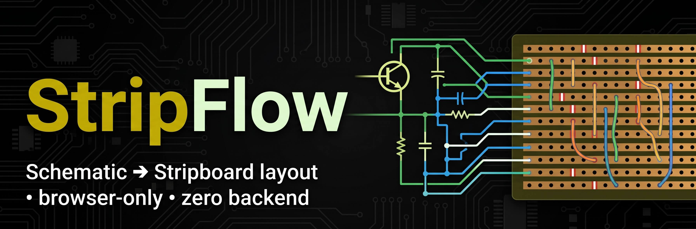
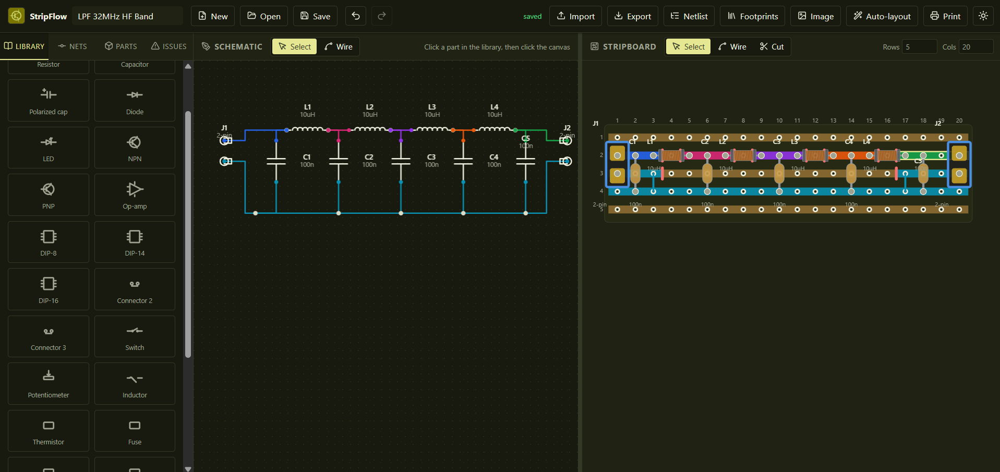

<p align="center">
  
</p>

<p align="center">
  <a href="https://muhammad-yunus.github.io/StripFlow/" target="_blank" rel="noopener noreferrer">
    
  </a>
  <a href="https://github.com/Muhammad-Yunus/StripFlow" target="_blank" rel="noopener noreferrer">
    
  </a>
</p>

<p align="center">
  <strong>Schematic → stripboard layout, browser-only, zero backend.</strong><br/>
  Draw a circuit, place parts on a virtual veroboard, let simulated-annealing auto-layout resolve cuts &amp; link wires, then print a 1:1 build template.
</p>

<br/>

<p align="center">
  
  
  
  
  
  
  
  
  
</p>

<p align="center">
  
</p>

---

## Features

| Feature area | Highlights |
|---|---|
| **Schematic editor** | Component library (R/C/L, diode, LED, transistors, op-amps, DIP ICs, connectors, switches, pots…), orthogonal wiring, auto net detection & coloring, GND/power flags, net labels, custom components, off-board marking, **KiCad-like draggable wires** (straight segments stay rigid, corners stay flexible, grid-snapped) |
| **Stripboard editor** | 2.54 mm hole grid, live copper-strip coloring per net, real-time conflict detection, drill/knife cuts, link wires, row/col insert & delete, flexible 2-pin lead span, lockable parts |
| **Auto-layout** | Sequence-pair + simulated-annealing router in a Web Worker with effort levels, board-size locking, cancellable progress; conflict-free result or an explained failure |
| **Print & export** | 1:1 component/cut sheets with calibration ruler, BOM, JSON round-trip, KiCad netlist + `StripFlow.pretty` footprint zip, PNG/SVG export, QR-coded boards |
| **Persistence** | IndexedDB project store, auto-save, 100+ step undo/redo, keyboard-first, dark mode |

No backend, no accounts, no network after load — everything stays in the browser.

## Quick start

No install, no build step:

```powershell
# any static server works (ES modules need HTTP, not file://)
python -m http.server 5173
# → open http://localhost:5173
```

Or just open `index.html` via `npx serve` / VS Code Live Server.

## Project structure

```
├── index.html              # App shell: two canvas panels + toolbars
├── css/                    # Custom-property theming, print styles
├── js/
│   ├── main.js             # Boot: store, renderers, workers, splitview
│   ├── core/               # Immutable state, event bus, geometry, IndexedDB
│   │   ├── store.js        #   Reducer store + undo/redo history
│   │   ├── autosave.js     #   Debounced IndexedDB persistence
│   │   └── geometry.js     #   Grid math, rotation, snapping
│   ├── schematic/          # Canvas schematic editor: library, renderer, tools
│   ├── board/              # Stripboard model: strips, cuts, pins, packages
│   ├── layout/             # Auto-layout pipeline
│   │   ├── seqpair.js      #   Initial placement heuristic
│   │   ├── decoder.js      #   SA candidate → concrete board
│   │   ├── annealer.js     #   Simulated annealing search
│   │   └── worker.js       #   Web Worker wrapper (non-blocking UI)
│   ├── export/             # JSON, KiCad netlist, PNG/SVG, print, QR
│   └── ui/                 # Toolbar, sidebar, menus, toasts, keyboard
└── docs/                   # PRD, ARCHITECTURE, TECH_STACK, CONVENTIONS
```

## Architecture

High-level data flow (details in [docs/ARCHITECTURE.md](docs/ARCHITECTURE.md)):

```
 user input ─► ui/* (events) ─► store.js (immutable state + history)
                                    │  event bus
        ┌───────────────────────────┴──────────────────────────────┐
        ▼                                                          ▼
 SchematicRenderer (Canvas 2D, read-only)              BoardRenderer (Canvas 2D, read-only)
        │                                                          │
        └──────► auto-layout (Web Worker) ◄────────────────────────┘
                  sequence pair → anneal → decode
                  │
                  └──► new immutable board state ──► re-render
```

Core rules:

- **State is immutable** — every mutation goes through the reducer in `js/core/store.js`; undo/redo are snapshots of that state.
- **Renderers are read-only** — canvases never mutate data; they project state to pixels.
- **Board coordinates are integer hole indices** — schematic cells and board holes are decouled, so parts can sit anywhere per package footprint.
- **Auto-layout never blocks the UI** — the SA loop runs in a module Web Worker and posts back progress + a proposed board state.

## Documentation

| File|Desc |
|---|---|
| [PRD](docs/PRD.md) | Scope, feature list, acceptance criteria, benchmarks |
| [Architecture](docs/ARCHITECTURE.md) | Module map, data model, state/undo, rendering, conflict detection, auto-layout |
| [Tech stack](docs/TECH_STACK.md) | Choices & rationale, performance budget, dependency policy |
| [Conventions](docs/CONVENTIONS.md) | Code style, naming, commit, testing rules |
| [AGENTS.md](AGENTS.md) | Guide for AI agents / contributors |

## Development

```powershell
python -m http.server 5173   # dev server (ES modules need HTTP)
npx eslint .                 # lint
npx prettier --check .       # format check
```

Unit tests live under `tests/unit` (`node --test tests/unit`) once added; see [docs/CONVENTIONS.md](docs/CONVENTIONS.md) for the testing rules.

## License

MIT
